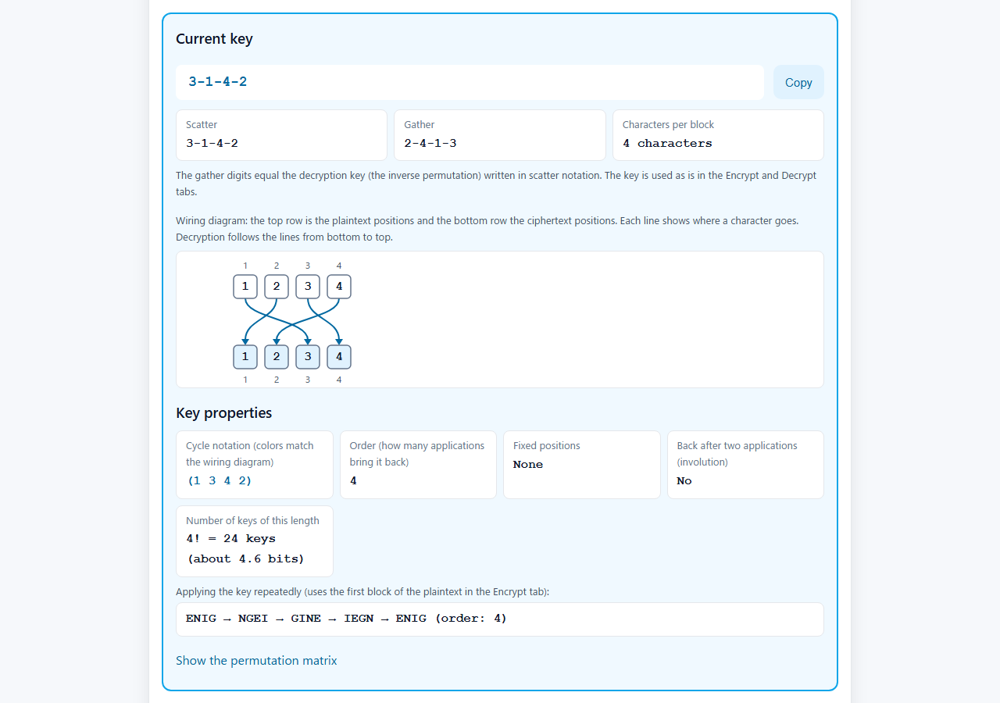
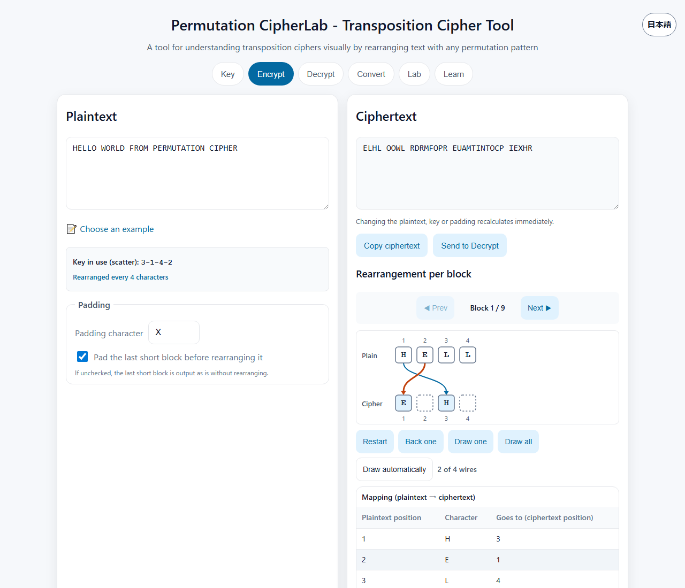
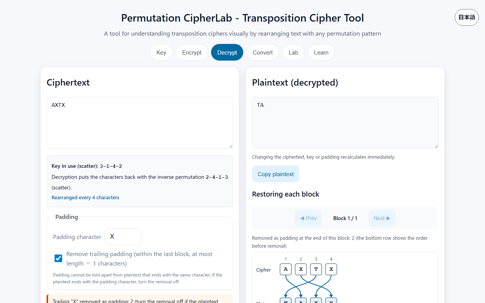
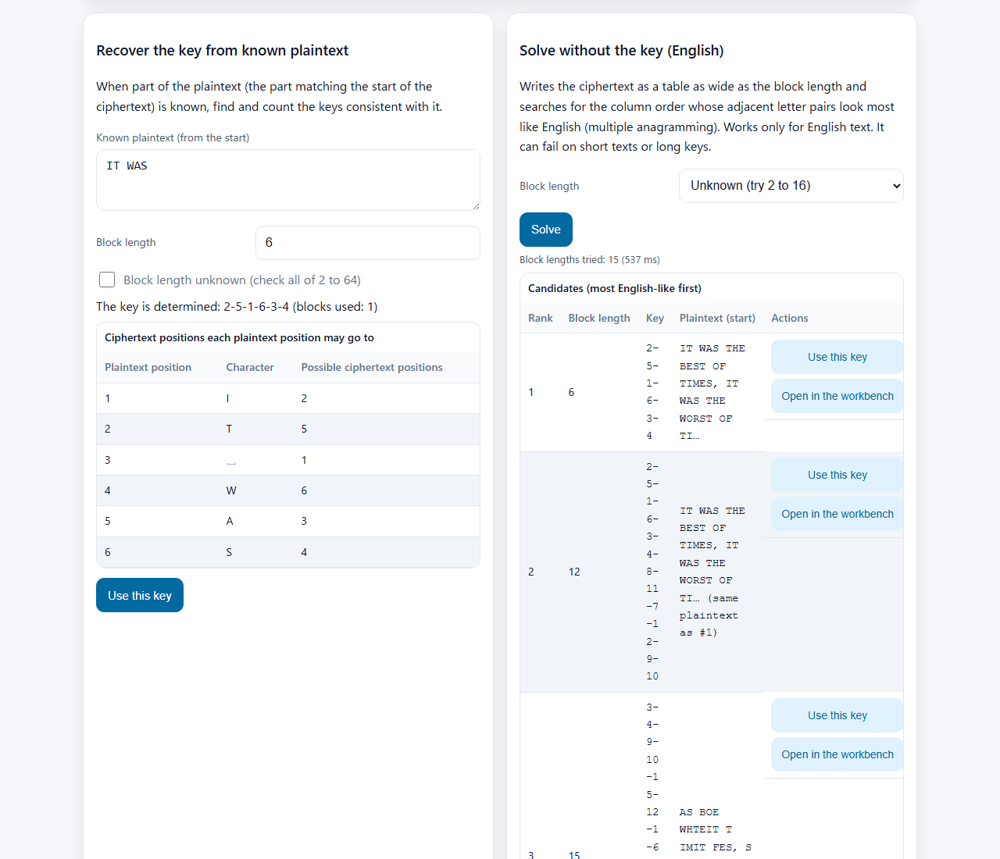
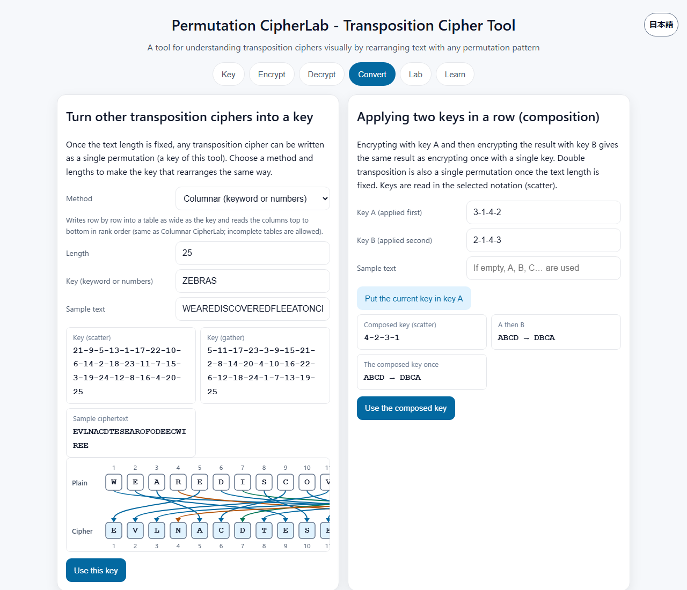

English · [日本語](README.md)

# Permutation CipherLab - Transposition Cipher Tool


[](https://ipusiron.github.io/permutation-cipherlab/)

**Day095 - 100 Security Tools with Generative AI**

**Permutation CipherLab** is a web tool for experiencing encryption and decryption by transposing text in any order (e.g. `3-1-4-2`).

You can enter and display key digits in either "scatter" or "gather" notation and follow where each character goes on a wiring diagram. In the Encrypt tab, you can draw the wires of a block one at a time to watch the rearrangement.

There is also a Convert tab that turns rail fence, columnar transposition and other ciphers into a single permutation, and a Lab that recovers keys from known plaintext or English statistics. The screen can be switched between Japanese and English.

---

## 🌐 Demo

👉 [https://ipusiron.github.io/permutation-cipherlab/](https://ipusiron.github.io/permutation-cipherlab/)

You can try it directly in your browser.

---

## 📸 Screenshots

>
>*The wiring diagram of key 3-1-4-2 and its two notations*

>
>*Following the rearrangement one wire at a time*

>
>*A note that padding cannot be told apart from the end of the plaintext*

>
>*The Lab: known plaintext and ciphertext-only solving*

>
>*The Convert tab: a columnar transposition as one permutation*

---

## 👥 Intended users

- Beginners in cryptography: people who want to learn the basics of classical ciphers by trying them
- Information security students: people who want to understand transposition ciphers with diagrams and use them in exercises
- Programming educators: people who want teaching material on permutations and array rearrangement
- Cryptography enthusiasts: people who want to experience the path from classical to modern ciphers
- CTF and puzzle authors: people who want to make transposition puzzles and check how they are solved
- Mathematics educators: people who want concrete examples of permutations and inverse mappings

---

## ⚙️ Features

### 🔑 Key tab

| Feature | Description |
|---|---|
| 🧭 Key notation | Switch between scatter (default) and gather notation. Only the way the digits are written changes, not the key |
| 🎲 Random | Creates a key of the given length (2 to 64) with cryptographic random numbers (`crypto.getRandomValues`, Fisher–Yates without modulo bias) |
| ✏️ Enter digits | Accepts `3-1-4-2`, `3 1 4 2`, `3,1,4,2` and full-width digits; set with Enter or "Apply". Errors show the reason (out of range, duplicates and missing numbers, and so on) |
| 🎨 Rearrange | Selecting two digits in turn swaps them. Works with the keyboard (Enter, Space, ← →, Esc) and mouse dragging |
| 📊 Wiring diagram | Draws lines from plaintext positions to ciphertext positions. Fixed positions are dashed |
| 🔁 Key properties | Cycle notation (in the wiring colors), order (how many applications bring it back), fixed positions, whether it is an involution, the number of keys (n! and bits), repeated application, and the permutation matrix (up to length 16) |
| 💾 Save and load | Saves keys by name in `localStorage`. Broken saved data is skipped with a count |

### 🔐 Encrypt tab

| Feature | Description |
|---|---|
| 🔄 Automatic | Recalculates the ciphertext as soon as the plaintext, key or padding changes |
| 🔲 Padding | Pads the last short block (default X) before rearranging. When off, the last short block is output as is |
| ⚠️ Notes | Warns when the plaintext ends with the padding character and when the last block was not rearranged |
| 🧩 Block wiring | Draws lines from each plaintext character to its ciphertext position, block by block |
| 🎞️ One wire at a time | Restart, back one, draw one, draw all, draw automatically. Rapid clicking does not break the state |
| 📋 Mapping table | Plaintext position, character and destination (ciphertext position) |
| 📤 Send to Decrypt | Passes the ciphertext and padding settings to the Decrypt tab |

### 🔓 Decrypt tab

| Feature | Description |
|---|---|
| ⏪ Inverse permutation | Computes the inverse of the key automatically and puts the characters back |
| ✂️ Remove padding | Removes trailing padding within the last block, at most length − 1 characters, and shows how many were removed |
| 🧩 Block wiring and table | Lines and a table from ciphertext positions to plaintext positions |

### 🔄 Convert tab

| Feature | Description |
|---|---|
| 🔀 Other transposition ciphers as a key | Turns rail fence (sequential or zigzag), scytale, columnar transposition (keyword or numbers), the spiral route cipher and reversal into one permutation of text length L. Shows the result and wiring for a sample text; "Use this key" sets it |
| ➕ Composing two keys | Shows that applying key A and then key B gives the same result as one composed key, which can then be set |

### 🕵️ Lab tab

| Feature | Description |
|---|---|
| 🔎 Key from known plaintext | Finds and counts the keys consistent with the known plaintext (from the start) and the ciphertext (counted up to block length 20). Also shows which ciphertext positions each plaintext position may go to. If the block length is unknown, checks all of 2 to 64 |
| 🧮 Solve without the key (English) | Solves with a given block length or tries 2 to 16 in turn, and lists the candidates in order of how English-like they are |
| 🧰 Workbench | Stacks the ciphertext in rows of the block length so you can swap columns and read. The joins between adjacent columns are colored in three levels |
| 📥 Receiving | Receives a ciphertext from another tool via `#text=` (or the older `?text=`) and opens it in the Lab. Solving does not start automatically |

### 📚 Learn tab

| Feature | Description |
|---|---|
| 🏛️ History | The history of transposition from the scytale to AES |
| 🔑 Principle and key notation | Transposition by permutation, and the difference between scatter and gather notation |
| 🔄 Blocks and padding | The effect of padding, and why padding cannot be told apart from the end of the plaintext |
| 🔐 Compared with substitution | The difference between transposition and substitution |
| ⚡ Strengths and weaknesses | The number of keys (n!) and how the cipher can be broken without the key |
| 🔗 Related techniques | Rail fence, columnar transposition, ADFGVX and DES, with related tools |

The screen can be switched between Japanese and English at the top right (or with `?lang=ja` and `?lang=en`). On the first visit, it is shown in Japanese if the browser language is Japanese and in English otherwise.

---

## 🧠 What is a transposition cipher?

A transposition (permutation) cipher only changes the order of the characters. Unlike a substitution cipher, the characters themselves do not change.

This tool is a block transposition cipher. With key length n as the block size, the plaintext is split into blocks of n characters, and every block is rearranged with the same key.

### 📜 Origins and history

- The Spartan scytale (writing on a leather strip wound around a rod) is often cited as the oldest example of a transposition cipher. Whether it was used as a cipher is disputed.
- From the 19th to the early 20th century, columnar transposition and the rail fence cipher were used. Double columnar transposition was used in World War I.
- In modern block ciphers, transposition such as the P-box (permutation box) provides diffusion.

### 🔍 Example: key 3-1-4-2 (scatter)

Key `3-1-4-2` sends "the character at position 1 to position 3, position 2 to position 1, position 3 to position 4, and position 4 to position 2".

| Original position | 1 | 2 | 3 | 4 |
|---|---|---|---|---|
| Plaintext | E | N | I | G |
| ↓ | →3 | →1 | →4 | →2 |
| Ciphertext | N | G | E | I |

The result is `ENIG`→`NGEI`. Decryption uses the inverse permutation `2-4-1-3` (scatter).

### 🧭 Key notation: scatter and gather

The same sequence of digits can be read in two ways.

- Scatter: plaintext character i goes to ciphertext position p[i] (the default in this tool).
- Gather: ciphertext character i is taken from plaintext character p[i].

The two are inverse permutations of each other. `3-1-4-2` (scatter) and `2-4-1-3` (gather) describe the same rearrangement. Sources and tools differ in notation, so if you pass on only the digits of a key, the receiver may read them the other way and get a different ciphertext.

| Notation | Key digits | Ciphertext of `ABCD` | Sources and tools using this notation |
|---|---|---|---|
| Scatter | `3-1-4-2` | `BDAC` | The default of this tool, CrypTool 2, Crypto Corner |
| Gather | `3-1-4-2` | `CADB` | Stinson, "Cryptography: Theory and Practice"; dCode; Japanese Wikipedia "Transposition cipher" |

Gaines' "Elementary Cryptanalysis" (1939) gives two uses of the same key `6 2 1 4 3 5` (`ABCDEF`→`FBADCE` and `CBEDFA`). The switch in the Key tab lets you enter and display keys in either notation.

### 📦 Blocks and padding

- With padding (default): when the last block is short, it is padded with the padding character (default `X`) before rearranging.
  - Example: `ENIGMA` (6 characters, key length 4) becomes `ENIG`→`NGEI` and `MA`→`MAXX`→`AXMX`, so the ciphertext is `NGEIAXMX`.
- Without padding: the last short block is output as is without rearranging, so part of the plaintext shows.
  - Example: `ENIGMA` becomes `NGEIMA`.

Padding cannot be told apart from plaintext that ends with the same character. Encrypting `TAX` with padding `X` gives `AXTX`, and removing the trailing X letters on decryption cuts it down to `TA`. This tool warns at encryption time when the plaintext ends with the padding character. With padding `Q`, `TAX` becomes `AQTX` and decrypts back to `TAX`.

Padding is removed on decryption only when the ciphertext length is a multiple of the key length, and at most length − 1 characters within the last block.

### ✅ Known answers

The following examples are re-encrypted by the logic module in `test/readme.test.js`.

| Key | Notation | Padding | Plaintext | Ciphertext |
|---|---|---|---|---|
| `3-1-4-2` | Scatter | X | `ENIG` | `NGEI` |
| `3-1-4-2` | Scatter | X | `ENIGMA IS FUN` | `NGEIAIM  USFXXNX` |
| `3-1-4-2` | Scatter | X | `ENIGMA` | `NGEIAXMX` |
| `3-1-4-2` | Scatter | None | `ENIGMA` | `NGEIMA` |
| `3 5 1 6 4 2` | Gather | None | `shesellsseashellsbytheseashore` | `eeslshsalseslshblehsyeethraeos` |
| `6 2 1 4 3 5` | Gather | None | `ABCDEF` | `FBADCE` |
| `6 2 1 4 3 5` | Scatter | None | `ABCDEF` | `CBEDFA` |

Row 5 is the example in Stinson's textbook (first edition, Example 1.6). It matches the printed ciphertext `EESLSHSALSESLSHBLEHSYEETHRAEOS` apart from case. This tool keeps upper and lower case as they are.

### 🔁 Permutation properties

A key (permutation) can be written as a combination of cycles. In key `3-1-4-2` (scatter), the character at position 1 moves to 3, 3 to 4, 4 to 2 and 2 to 1, so its cycle notation is `(1 3 4 2)`.

- Order: how many applications of the same key bring it back. It is the least common multiple of the cycle lengths; 4 for `3-1-4-2`. Encrypting `ENIG` four times gives `ENIG`→`NGEI`→`GINE`→`IEGN`→`ENIG`.
- Fixed positions: positions whose character does not move. They are dashed in the wiring diagram.
- Involution: a key that comes back after two applications (it is its own inverse). For such a key, the scatter and gather digits are the same.
- Number of keys: there are n! keys of length n. For length 16 that is `16! = 20,922,789,888,000` keys (about 44.3 bits).
- Permutation matrix: the matrix whose entry in row j, column i is 1 when the character at plaintext position i moves to ciphertext position j. Stinson's textbook treats the transposition cipher as the special case of the Hill cipher whose key is this matrix.

### 🕵️ Solving without the key (the Lab)

A transposition cipher rearranges every block with the same key. Because of this, it can be solved without the key, however many keys there are.

#### Recovering the key from known plaintext

If part of the plaintext (the part matching the start of the ciphertext) is known, the key can be found by looking up where each plaintext character is in the same block of the ciphertext. When a block contains the same character more than once, it cannot be told which copy went where, so candidates remain. The number of remaining keys is counted from the overlap of the candidates across the blocks used (up to block length 20).

| Key (scatter) | Known plaintext | Blocks used | Keys remaining |
|---|---|---|---|
| `3-1-4-2` | `ENIG` | 1 | 1 |
| `3-1-4-2` | `HELL` | 1 | 2 |
| `3-1-4-2` | `AAAA` | 1 | 24 |
| `5-2-8-1-7-3-6-4` | `ATTACK A` | 1 | 12 |
| `5-2-8-1-7-3-6-4` | `ATTACK AT DAWNXX` | 2 | 1 |

`ATTACK A` has three A's and two T's, so 3! × 2! = 12 keys remain. Using the second block as well determines the key.

#### Solving an English ciphertext without the key (multiple anagramming)

When the ciphertext is laid out in a table as wide as the block length k, block transposition becomes "reordering the columns of the table". Every row is reordered the same way, so the tool adds up how English-like (by letter-pair statistics) it is to read column b right after column a over all rows, and searches for the column order with the highest score. It also counts the join from the end of one row to the start of the next, which fixes where the reading order starts.

- The column order is found exactly, as the maximum score, by bitmask dynamic programming (the same form as the Held–Karp method for the travelling salesman problem). k is up to 16.
- When the block length is unknown, all of 2 to 16 are solved and ranked by the total score minus 2 × log10(k!). This is because larger k gives more freedom in ordering and tends to score higher. A candidate whose k is a multiple can give the same plaintext (shown as "same plaintext as #1").
- The letter-pair statistics were built from "Pride and Prejudice" (Project Gutenberg #1342) with `tools/build-bigrams.py`. A 28-symbol table with spaces is used when the ciphertext contains spaces or symbols, and a 26-symbol table when it has letters only.

The success rate is the share of cases in which the plaintext came back exactly, for English text from "A Tale of Two Cities" (#98, not used for the statistics) encrypted with random keys (padding X). 30 trials each with `tools/eval-solver.js`; the results are in `tools/eval-solver-result.json`.

English text with spaces, with the block length given.

| Length | k=4 | k=6 | k=8 | k=10 | k=12 | k=14 | k=16 |
|---|---|---|---|---|---|---|---|
| 60 chars | 100% | 100% | 100% | 90% | 57% | 70% | 23% |
| 100 chars | 100% | 100% | 100% | 100% | 100% | 97% | 83% |
| 200 chars | 100% | 100% | 100% | 100% | 100% | 100% | 100% |
| 400 chars | 100% | 100% | 100% | 100% | 100% | 100% | 100% |

English text with letters only, with the block length given.

| Length | k=4 | k=6 | k=8 | k=10 | k=12 | k=14 | k=16 |
|---|---|---|---|---|---|---|---|
| 60 chars | 100% | 97% | 97% | 40% | 13% | 30% | 0% |
| 100 chars | 100% | 100% | 100% | 97% | 90% | 53% | 50% |
| 200 chars | 100% | 100% | 100% | 97% | 100% | 100% | 97% |
| 400 chars | 100% | 100% | 100% | 100% | 100% | 100% | 100% |

When the block length is unknown (random from 3 to 12), the top candidate gave back the plaintext in 100% of cases at 100 characters and 93% at 200 characters for text with spaces, and in 87% at 100 characters and 93% at 200 characters for letters only.

It does not work for languages other than English (such as Japanese). It can fail on short texts or long keys. When it fails, you can swap columns in the workbench and fix the order by hand, using the join colors.

---

## 🔀 Comparison with other transposition ciphers

| Cipher | How it encrypts | Key form | Unit | History | Security | Tool in this project |
|---|---|---|---|---|---|---|
| Block transposition (this tool) | Rearranges every fixed-length block with the same permutation | A sequence of numbers (e.g. `3-1-4-2`) | Fixed-length blocks | The basic form defined in textbooks | n! keys, but breakable by multiple anagramming | This tool |
| Scytale | Writes on a leather strip wound around a rod and reads it unwound | Rod thickness (characters per turn) | Whole text | Ancient Greece, Sparta | Very low (few possible keys) | [Scytale Cipher Visualizer](https://ipusiron.github.io/scytale-cipher-visualizer/) |
| Rail fence | Places characters on rails and reads rail by rail | Number of rails | Whole text | Said to have been used by both sides in the American Civil War | Very low (few possible keys) | [RailFence CipherLab](https://ipusiron.github.io/railfence-cipherlab/) |
| Columnar transposition | Writes in rows and reads the columns in key order | A keyword or numbers | Whole text | Used by the military in World War I | Low to medium (depends on key length) | [Columnar CipherLab](https://ipusiron.github.io/columnar-cipherlab/) |
| Route cipher | Places characters in a grid and reads along a set route (such as a spiral) | Grid size and route | Whole text | Used in the American Civil War and elsewhere | Low (few kinds of routes) | The Convert tab of this tool (spiral) |
| Double transposition | Applies columnar transposition twice | Two keys | Whole text | Used in World Wars I and II | Medium (stronger than a single transposition) | Double transposition in [Columnar CipherLab](https://ipusiron.github.io/columnar-cipherlab/) |

Once the text length is fixed, the scytale, rail fence, columnar transposition, route cipher and double transposition can each be written as a single permutation. In this tool, setting the key length to the text length reproduces that permutation as the key of one block. The Convert tab makes this key just by choosing the method and lengths.

### 💡 Equivalence with the rail fence cipher (sequential)

Method 1 (sequential) of [RailFence CipherLab](https://ipusiron.github.io/railfence-cipherlab/) (Day034) deals the characters to the rails in the order 1→2→…→r→1… and reads rail by rail. When the text length n is a multiple of the number of rails r (c = n/r characters per rail), the key of this tool (scatter) is given by the following formula, with i starting from 0.

```
p[i] = (i mod r) × c + ⌊i / r⌋ + 1
```

| Rails | Plaintext | Rail fence ciphertext | Key of this tool (scatter) | Same key (gather) |
|---|---|---|---|---|
| 2 | `ABCDEFGH` | `ACEGBDFH` | `1-5-2-6-3-7-4-8` | `1-3-5-7-2-4-6-8` |
| 3 | `ABCDEFGHI` | `ADGBEHCFI` | `1-4-7-2-5-8-3-6-9` | `1-4-7-2-5-8-3-6-9` |
| 4 | `ABCDEFGHIJKL` | `AEIBFJCGKDHL` | `1-4-7-10-2-5-8-11-3-6-9-12` | `1-5-9-2-6-10-3-7-11-4-8-12` |

The key for 3 rails and 9 characters is its own inverse (an involution), so the digits are the same in both notations.

To try it (choosing "Rail fence (sequential)", length 8 and 2 rails in the Convert tab makes the same key):

1. In the Key tab, choose scatter notation and enter `1-5-2-6-3-7-4-8`.
2. Encrypt `ABCDEFGH` in the Encrypt tab and check that it becomes `ACEGBDFH`.
3. Switch to gather notation; the same key is shown as `1-3-5-7-2-4-6-8`.
4. Try the same plaintext with 2 rails and method 1 in RailFence CipherLab and compare.

If the plaintext length differs from the key length, this tool splits it into several blocks, so the result differs from the rail fence. To check the equivalence, make the plaintext length equal to the key length.

### 💡 Equivalence with columnar transposition

[Columnar CipherLab](https://ipusiron.github.io/columnar-cipherlab/) (Day043) writes the plaintext in rows as wide as the number of columns and reads each column from top to bottom in increasing order of rank (the numbers of the numeric key). With the numbers `3 1 4 2`, it reads column 2 → column 4 → column 1 → column 3.

```
Input: ABCDEFGHIJKL (4 columns × 3 rows)
Column: 1 2 3 4
        A B C D
        E F G H
        I J K L
Read:   column 2 (BFJ) → column 4 (DHL) → column 1 (AEI) → column 3 (CGK)
Ciphertext: BFJDHLAEICGK
```

The destination of each character is "(rank of its column − 1) × number of rows + row number". For example, A is in row 1 of column 1 (rank 3), so it goes to position (3 − 1) × 3 + 1 = 7.

| Numbers (Day043) | Plaintext | Columnar ciphertext | Key of this tool (scatter, length 12) |
|---|---|---|---|
| `3 1 4 2` | `ABCDEFGHIJKL` | `BFJDHLAEICGK` | `7-1-10-4-8-2-11-5-9-3-12-6` |

Encrypting `ABCDEFGHIJKL` with this key gives `BFJDHLAEICGK`. When the number of rows changes, so does the key, so one columnar key corresponds to a different permutation for each text length.

### 🔍 Where this tool fits

- Flexibility: any permutation can be a key. Other transposition ciphers can be reproduced as a single permutation once the length is fixed.
- Visualization: the wiring diagram and one-wire-at-a-time drawing let you follow where each character goes.
- Explicit notation: switching between scatter and gather shows how sources write keys differently.
- Education: permutations, inverse permutations, the number of keys (n!) and padding can be learned by doing.

---

## 💬 Educational value

- Understand intuitively that a simple rearrangement can work as a "key".
- Learn the difference between the two basic elements of ciphers, substitution and transposition (permutation), by doing.
- Experience the starting point of the "substitution + transposition" structure used in block ciphers such as DES and AES.

---

## 🎯 Use cases

### Ways of using this tool in particular

- Checking the direction of a rearrangement in code (development, data processing): there are two ways to rearrange an array, `out[p[i]] = x[i]` (scatter) and `out[i] = x[p[i]]` (gather; NumPy's `x[p]` has this form). Rearranging `ABCD` with `3-1-4-2` gives `BDAC` in scatter notation and `CADB` in gather notation. Switching notations and comparing the two results for the same digits shows whether a column swap or data rearrangement used the wrong direction.
- Studying the faro shuffle with playing cards (magic, mathematics): the out-shuffle, which splits an 8-card deck in half and interleaves the halves, is the scatter key `1-3-5-7-2-4-6-8`. Under "Applying the key repeatedly" in the key properties, `ABCDEFGH` changes as `AEBFCGDH`→`ACEGBDFH`→`ABCDEFGH`, and the order is shown as 3. 52 cards (key length 52) come back after 8 shuffles. Read in gather notation, the same digits are the key of a 2-rail rail fence.
- Thinking about padding in fixed-length data (data design): encrypting `TAX` with padding `X` gives `AXTX`, and removing the trailing X letters on decryption cuts it down to `TA`. This is the same problem as padding fixed-length records with spaces, after which the original trailing spaces cannot be told apart; it shows why schemes that record the padding count (such as PKCS#7) are used.
- Checking seating or layout changes (schools, workplaces): scatter notation reads "person i goes to seat p[i]" and gather notation reads "seat i gets person p[i]". The wiring diagram shows who moves where, and the dashed lines (fixed positions) can be counted. With `3-1-4-2` all four people move, and the inverse permutation `2-4-1-3` puts them back.
- Showing that the number of keys is not security (classes): there are `16! = 20,922,789,888,000` keys of length 16 (about 44.3 bits), yet for 200 characters of English text with spaces, ciphertext-only solving in the Lab (block length 16 given) gave back the plaintext in all 30 trials. The numbers show that adding keys does not help when the same key is reused for every block.
- Checking implementations of other transposition ciphers as one permutation (development): turning the ZEBRAS columnar transposition into a key of length 25 in the Convert tab changes `WEAREDISCOVEREDFLEEATONCE` into `EVLNACDTESEAROFODEECWIREE`, which matches Columnar CipherLab (Day043). Double transposition can also be composed into one key, and the wiring diagram shows where each character goes.

### General uses

#### Making CTF and puzzle challenges and practicing solutions

1. In the Key tab, choose key length 4 and generate a random key or enter `3-1-4-2`.
2. Enter a plaintext (e.g. `FLAG{TRY_PERM}`) in the Encrypt tab. With padding the ciphertext is `LGFATY{RPR_E}XMX`.
3. Publish the ciphertext as a challenge and give hints step by step, such as "the block length is 4" and "the padding is X".
4. Use the Decrypt tab of this tool to check answers.

Participants experience block processing, the role of padding, and decryption by guessing the key. It suits the stage of grasping the mechanism by hand before writing scripts. If the plaintext is known to start with `FLAG`, the known-plaintext attack in the Lab determines the key `3-1-4-2` from the first block (4 characters) alone.

#### Training material for red team exercises and penetration testing (education)

Prepare a "dummy log" or "configuration file" imitating an internal system with legacy transposition-based processing, and build a scenario for practicing analysis and decryption.

The planned flow (exercise design) is as follows.

1. Prepare dummy data in the format of an old system's logs and hide hints or flags with a simple transposition.
2. Learners try to decrypt it by hand with this tool and proceed to the next stage of the exercise (such as simulated authentication attempts) with the result.
3. After the exercise, review log preservation, design flaws in the encryption, and auditing points for detection.

Run the exercise in an isolated environment and do not target production systems. The goal is to understand what happens when simple ciphers remain in logs and settings, and to learn the importance of auditing, log normalization and key management.

#### Teaching material for classes and workshops (a 50-minute example)

1. 10 minutes: explain the history of the scytale and columnar transposition with the Learn tab.
2. 15 minutes: set `3-1-4-2` in the Key tab and show the wiring diagram and the two notations.
3. 15 minutes: encrypt `HELLO WORLD FROM PERMUTATION CIPHER` in the Encrypt tab and follow the rearrangement of each block one wire at a time.
4. 5 minutes: decrypt in the Decrypt tab and check the role of the inverse permutation.
5. 5 minutes: discuss how padding affects the result with and without padding and the `TAX` example.

#### Checking implementations in development and research

- Check implementations of columnar transposition and the rail fence against the equivalent keys of this tool.
- Compare results with and without padding and with different padding characters to find inconsistencies.
- Use the wiring diagrams and mapping tables as figures in teaching materials and articles.
- Check with the block wiring diagrams that the inverse permutation decrypts correctly.

Because you can try only the transposition part, again and again with small inputs, mistakes in implementations and differences in specifications can be found early.

This tool is meant for education, research and defense. The author does not encourage misuse.

---

## 🔗 Related tools

- [RailFence CipherLab](https://ipusiron.github.io/railfence-cipherlab/) (Day034): the rail fence cipher
- [Columnar CipherLab](https://ipusiron.github.io/columnar-cipherlab/) (Day043): columnar transposition and its solver lab
- [Scytale Cipher Visualizer](https://ipusiron.github.io/scytale-cipher-visualizer/) (Day010): the scytale
- [Cipher Clairvoyance](https://ipusiron.github.io/cipher-clairvoyance/) (Day044): estimates which cipher was used, and can pass a ciphertext judged to be a transposition to the Lab of this tool
- [Hill CipherLab](https://ipusiron.github.io/hill-cipherlab/) (Day093): a substitution cipher based on linear algebra (with a permutation matrix as the key it becomes a transposition cipher)
- [ToySPN Builder](https://ipusiron.github.io/toyspn-builder/) (Day094): the basic structure of modern ciphers combining substitution and transposition

---

## 🔒 Security

This tool is a static web application that runs entirely in the browser. It does not send the text or keys you enter anywhere.

- XSS protection: user text is shown with `textContent` or SVG `text` elements and never interpreted as HTML.
- CSP: `<meta>` specifies `default-src 'self'`, `script-src 'self'`, `style-src 'self'` and more, and no inline scripts or style attributes are used.
- Random numbers: keys are generated with cryptographic random numbers (`crypto.getRandomValues`), rejecting values that would cause modulo bias.
- Storage: keys are saved in `localStorage`. Saved data is validated when loaded, and broken items are skipped.
- Links: external links use `rel="noopener noreferrer"`, and the page `referrer` is `no-referrer`.
- Receiving: a ciphertext received from another tool via `#text=` (or the older `?text=`) is put into the input and then removed from the URL. The part after `#` is not sent to the server. The browser history still keeps the original URL.

See [SECURITY.md](SECURITY.md) for details and [IMPLEMENTATION.md](IMPLEMENTATION.md) for the implementation.

### ⚠️ Notes

- This tool is for education and research. Transposition ciphers are not secure by modern standards, so do not use them to protect real secrets.
- However many keys there are, every block is rearranged with the same key, so the cipher can be broken by stacking the blocks and reordering the columns (multiple anagramming).
- Do not enter confidential or personal information.

---

## 🧪 Tests

```bash
npm test
```

- Runs on Node.js 22 or later. There are no dependencies (only `node --test` is used).
- Runs automatically on GitHub Actions for every push and pull request.
- Checks known answers of the logic module (including the tables in this README), round trips for n = 2 to 64, emoji and combining characters, padding edge cases, random-number bias, permutation properties, conversion from other transposition ciphers (matching Day010, 034 and 043), the number of keys from known plaintext, and ciphertext-only solving.
- Checks the HTML statically (CSP, ARIA, no inline event handlers), color contrast, Japanese–English message consistency, that every Japanese string in index.html has an English translation, and the structure and table values of this README and the Japanese one.
- Checks that the success-rate tables of ciphertext-only solving match the output of `tools/eval-solver.js` (`tools/eval-solver-result.json`). To recompute them, put the training and evaluation texts (Project Gutenberg #1342 and #98) in `tools/corpus/`.

---

## 📁 Directory structure

```
permutation-cipherlab/
├── .github/                     # GitHub settings
│   └── workflows/               # GitHub Actions definitions
│       └── test.yml             # Runs npm test on every push and pull request
├── assets/                      # README images
│   ├── en/                      # Screenshots of the English screen (README.en.md)
│   │   ├── screenshot.png       # Key tab (English)
│   │   ├── screenshot2.png      # Encrypt tab (English)
│   │   ├── screenshot3.png      # Decrypt tab (English)
│   │   ├── screenshot4.png      # Lab (English)
│   │   └── screenshot5.png      # Convert tab (English)
│   ├── screenshot.png           # Key tab (wiring, two notations, key properties)
│   ├── screenshot2.png          # Encrypt tab (drawing the wires one by one)
│   ├── screenshot3.png          # Decrypt tab (padding removed, with a note)
│   ├── screenshot4.png          # Lab (known plaintext and ciphertext-only solving)
│   └── screenshot5.png          # Convert tab (columnar transposition as one key)
├── js/                          # Logic modules and screen parts
│   ├── english-bigrams.js       # English letter-pair statistics (for ciphertext-only scoring; built by tools/build-bigrams.py)
│   ├── i18n-en.js               # English for the screen (table from the Japanese strings in index.html)
│   ├── i18n.js                  # Japanese/English switching (keeps the originals and swaps them)
│   ├── messages.js              # Messages produced by JavaScript
│   ├── permutation-core.js      # Key validation, notation, encryption, decryption, properties, conversion, known plaintext (no DOM)
│   ├── solver.js                # Ciphertext-only solving (multiple anagramming; no DOM)
│   └── wiring.js                # Draws the wiring diagrams (SVG)
├── test/                        # node:test tests
│   ├── contrast.test.js         # Contrast ratios of text and background
│   ├── core.test.js             # Known answers, round trips and edge cases of the logic module
│   ├── core2.test.js            # Permutation properties, conversion from other ciphers, known plaintext
│   ├── format.test.js           # Line length, line endings, invisible characters
│   ├── html.test.js             # Static checks of CSP, ARIA and inline attributes
│   ├── i18n.test.js             # Japanese/English messages and the English screen strings
│   ├── messages.test.js         # Message dictionary and the keys used on screen
│   ├── readme.test.js           # Examples, tables and structure of the READMEs
│   └── solver.test.js           # Ciphertext-only solving and the statistics tables
├── tools/                       # Development scripts
│   ├── build-bigrams.py         # Builds the English letter-pair statistics (download the text into tools/corpus/)
│   ├── eval-solver-result.json  # Success rates of ciphertext-only solving (output of eval-solver.js)
│   └── eval-solver.js           # Measures the success rates of ciphertext-only solving (fixed random seed)
├── .gitignore                   # Git ignore settings
├── .nojekyll                    # Disables Jekyll on GitHub Pages
├── CLAUDE.md                    # Development guide for Claude Code
├── IMPLEMENTATION.md            # Implementation details (for developers)
├── index.html                   # The screen (Key, Encrypt, Decrypt, Convert, Lab and Learn tabs)
├── LICENSE                      # MIT License
├── package.json                 # npm test definition (no dependencies)
├── README.en.md                 # This file
├── README.md                    # README in Japanese
├── script.js                    # Screen control (state, events, drawing)
├── SECURITY.md                  # Security policy and headers for hosting
└── style.css                    # Stylesheet
```

---

## 💻 Requirements

- Works on the latest Chrome, Edge, Firefox and Safari.
- Works when `index.html` is opened directly (`file://`) and when served from a web server.
- To serve locally, for example, run `python -m http.server 8000` and open `http://localhost:8000/`.
- The screen is in Japanese and English (switch at the top right, or use `?lang=ja` and `?lang=en`).

---

## 📄 License

MIT License – see [LICENSE](LICENSE) for details.

---

## 🛠️ About this tool

This tool was developed as part of the "100 Security Tools with Generative AI" project.
In this project, a variety of security-related tools are built and released over 100 days with the help of AI.

For details on the project and other tools, see the following page.

🔗 [https://akademeia.info/?page_id=42163](https://akademeia.info/?page_id=42163)
