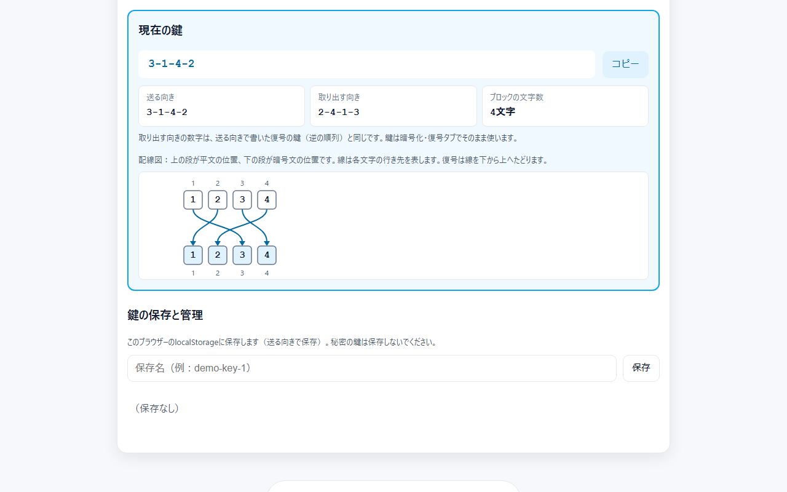
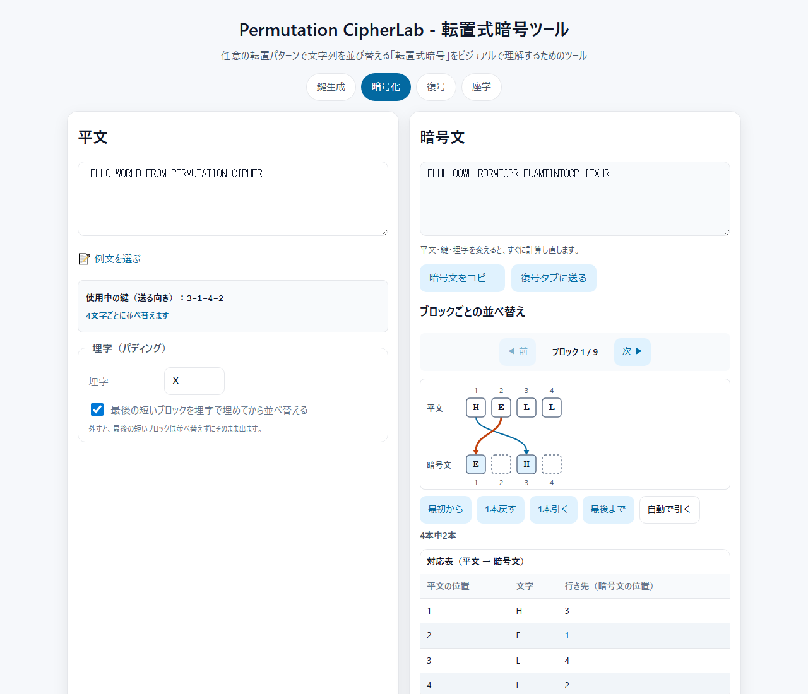
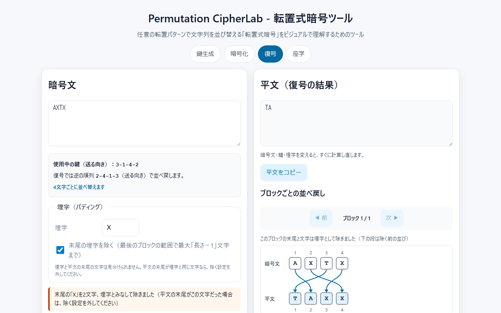

<!--
---
id: day095
slug: permutation-cipherlab

title: "Permutation CipherLab"

subtitle_ja: "転置式暗号ツール"
subtitle_en: "Permutation Cipher Visualization Tool"

description_ja: "任意の転置パターンで文字列を並び替える転置式暗号をビジュアルで理解するためのツール。鍵の向き（送る／取り出す）を切り替えて入力でき、配線図と1本ずつ引く操作で、ブロックごとの並べ替えと復号を確かめられます。"
description_en: "Interactive tool for exploring permutation ciphers. Enter keys in either notation (scatter or gather), and follow each block's rearrangement and decryption on a wiring diagram, one wire at a time."

category_ja:
  - 古典暗号
  - 転置式暗号
  - 現代暗号
  - ブロック暗号
category_en:
  - Classical Cryptography
  - Transposition Cipher
  - Modern Cryptography
  - Block Cipher

difficulty: 4

tags:
  - cipher
  - permutation
  - transposition
  - block-cipher
  - visualization
  - education
  - javascript

repo_url: "https://github.com/ipusiron/permutation-cipherlab"
demo_url: "https://ipusiron.github.io/permutation-cipherlab/"

hub: true
---
-->

# Permutation CipherLab - 転置式暗号ツール


[](https://ipusiron.github.io/permutation-cipherlab/)

**Day095 - 生成AIで作るセキュリティツール100**

**Permutation CipherLab**は、文字列を任意の並び順（例：`3-1-4-2`）で転置して、暗号化・復号を体験できるWebツールです。

鍵の数字を「送る向き」と「取り出す向き」のどちらでも入力・表示でき、配線図で各文字の行き先をたどれます。暗号化タブでは、ブロックの線を1本ずつ引いて並べ替えの様子を確かめられます。

---

## 🌐 デモページ

👉 [https://ipusiron.github.io/permutation-cipherlab/](https://ipusiron.github.io/permutation-cipherlab/)

ブラウザーで直接お試しいただけます。

---

## 📸 スクリーンショット

>
>*鍵3-1-4-2の配線図と、2通りの書き方*

>
>*線を1本ずつ引いて並べ替えをたどる*

>
>*埋字と平文の末尾は見分けられないことを示す注意*

---

## 👥 対象ユーザー

- 暗号理論の初学者：古典暗号の基本を、実際に操作しながら学びたい人
- 情報セキュリティを学ぶ学生：転置式暗号の仕組みを図で理解し、演習に使いたい人
- プログラミング教育者：順列・配列の並べ替えの教材として使いたい人
- 暗号技術の愛好家：古典暗号から現代暗号への発展を体験的に学びたい人
- CTF・謎解きの作問者：転置式暗号を使った問題を作り、解き方を確かめたい人
- 数学教育者：順列と逆写像を具体例で説明したい人

---

## ⚙️ 主な機能

### 🔑 鍵生成タブ

| 機能 | 説明 |
|---|---|
| 🧭 鍵の向き | 送る向き（既定）と取り出す向きを切り替える。鍵そのものは変えず、数字の書き方だけを変える |
| 🎲 ランダム生成 | 指定した長さ（2〜64）の鍵を、暗号用の乱数（`crypto.getRandomValues`、偏りを除くFisher–Yates法）で作る |
| ✏️ 数字で入力 | `3-1-4-2`・`3 1 4 2`・`3,1,4,2`・全角数字を受け付け、Enterか「適用」で設定する。誤りは理由（範囲外・重複と足りない数など）を示す |
| 🎨 並べ替えて作る | 2つを順に選ぶと入れ替わる。キーボード（Enter・Space・←→・Esc）とマウスのドラッグにも対応 |
| 📊 配線図 | 平文の位置から暗号文の位置へ線を引く。動かない位置は破線で示す |
| 💾 保存と読み込み | `localStorage`に名前つきで保存する。壊れた保存データは件数を示して読み飛ばす |

### 🔐 暗号化タブ

| 機能 | 説明 |
|---|---|
| 🔄 自動で計算 | 平文・鍵・埋字を変えると、すぐに暗号文を計算し直す |
| 🔲 埋字（パディング） | 最後の短いブロックを埋字（既定はX）で埋めてから並べ替える。外すと最後の短いブロックはそのまま出る |
| ⚠️ 注意の表示 | 平文の末尾が埋字と同じ文字のとき、最後のブロックを並べ替えなかったときに知らせる |
| 🧩 ブロックの配線図 | ブロックごとに、平文の文字から暗号文の位置への線を描く |
| 🎞️ 1本ずつ引く | 最初から・1本戻す・1本引く・最後まで・自動で引く。連打しても状態は崩れない |
| 📋 対応表 | 平文の位置・文字・行き先（暗号文の位置）を表で示す |
| 📤 復号タブへ送る | 暗号文と埋字の設定を復号タブに渡す |

### 🔓 復号タブ

| 機能 | 説明 |
|---|---|
| ⏪ 逆の順列で復号 | 鍵の逆の順列を自動で求めて並べ戻す |
| ✂️ 埋字を除く | 末尾の埋字を、最後のブロックの範囲で最大「長さ−1」文字まで除き、除いた数を示す |
| 🧩 ブロックの配線図と対応表 | 暗号文の位置から平文の位置への線と、表 |

### 📚 座学タブ

| 機能 | 説明 |
|---|---|
| 🏛️ 歴史 | スキュタレーからAESまでの転置の歴史 |
| 🔑 基本原理と鍵の向き | 順列による転置と、送る向き・取り出す向きの違い |
| 🔄 ブロックと埋字 | 埋字の有無による違いと、埋字と平文の末尾が見分けられないこと |
| 🔐 置換暗号との比較 | 転置と置換の違い |
| ⚡ 強度と弱点 | 鍵の数（n!）と、鍵を知らなくても解ける方法 |
| 🔗 関連する暗号技術 | レールフェンス・縦列転置・ADFGVX・DESと、関連するツール |

---

## 🧠 転置式暗号とは

転置式暗号（Permutation Cipher）は、文字の並び順だけを入れ替える暗号です。置換暗号とは違い、文字そのものは変わりません。

本ツールはブロック単位の転置式暗号です。鍵の長さnをブロックの文字数として平文をn文字ずつに分け、どのブロックも同じ鍵で並べ替えます。

### 📜 起源と歴史

- 古代スパルタのスキュタレー（棒に革ひもを巻きつけて書く方式）が、転置式暗号の最も古い例としてよく挙げられる。暗号として使われたかには異論もある。
- 19世紀から20世紀前半にかけて、縦列転置式暗号やレールフェンス暗号が使われた。第一次世界大戦では二重の縦列転置が使われた。
- 現代のブロック暗号では、P-Box（Permutation Box）などの転置が拡散（diffusion）を担う。

### 🔍 例：鍵3-1-4-2（送る向き）

鍵`3-1-4-2`は「位置1の文字を位置3へ、位置2の文字を位置1へ、位置3の文字を位置4へ、位置4の文字を位置2へ」送ります。

| 元の位置 | 1 | 2 | 3 | 4 |
|---|---|---|---|---|
| 平文 | E | N | I | G |
| ↓ | →3 | →1 | →4 | →2 |
| 暗号文 | N | G | E | I |

結果は`ENIG`→`NGEI`です。復号には逆の順列`2-4-1-3`（送る向き）を使います。

### 🧭 鍵の向き：送る向きと取り出す向き

同じ数字の並びでも、読み方が2通りあります。

- 送る向き：平文のi文字目を、暗号文の位置p[i]へ送る（本ツールの既定）。
- 取り出す向き：暗号文のi文字目を、平文のp[i]文字目から取る。

2つは互いに逆の順列です。`3-1-4-2`（送る向き）と`2-4-1-3`（取り出す向き）は同じ並べ替えを表します。資料やツールによって向きが違うので、鍵の数字だけを渡すと、受け取った側が逆に読んで別の暗号文になることがあります。

| 書き方 | 鍵の数字 | `ABCD`の暗号文 | この向きを使う資料・ツールの例 |
|---|---|---|---|
| 送る向き | `3-1-4-2` | `BDAC` | 本ツールの既定、CrypTool 2、Crypto Corner |
| 取り出す向き | `3-1-4-2` | `CADB` | Stinson『Cryptography: Theory and Practice』、dCode、日本語版Wikipedia「転置式暗号」 |

Gaines『Elementary Cryptanalysis』（1939）は、同じ鍵`6 2 1 4 3 5`の2通りの使い方（`ABCDEF`→`FBADCE`と`CBEDFA`）を挙げています。鍵生成タブの切り替えで、どちらの向きでも入力・表示できます。

### 📦 ブロック処理と埋字（パディング）

- 埋字あり（既定）：最後のブロックが足りないとき、埋字（既定は`X`）で埋めてから並べ替える。
  - 例：`ENIGMA`（6文字、鍵の長さ4）は`ENIG`→`NGEI`、`MA`→`MAXX`→`AXMX`で、暗号文は`NGEIAXMX`。
- 埋字なし：最後の短いブロックは並べ替えずにそのまま出す。平文の一部がそのまま見える。
  - 例：`ENIGMA`は`NGEIMA`。

埋字と平文の末尾の文字は、暗号文からは見分けられません。`TAX`を埋字`X`で暗号化すると`AXTX`になり、復号で末尾のXを除くと`TA`まで削れます。本ツールは、平文の末尾が埋字と同じ文字なら暗号化のときに知らせます。埋字を`Q`にすると`TAX`は`AQTX`になり、復号で`TAX`に戻ります。

復号で除く埋字は、暗号文の長さが鍵の長さの倍数のときだけ、最後のブロックの範囲で最大「長さ−1」文字までです。

### ✅ 既知解答

次の例は`test/readme.test.js`が計算部で暗号化し直して確かめています。

| 鍵 | 向き | 埋字 | 平文 | 暗号文 |
|---|---|---|---|---|
| `3-1-4-2` | 送る | X | `ENIG` | `NGEI` |
| `3-1-4-2` | 送る | X | `ENIGMA IS FUN` | `NGEIAIM  USFXXNX` |
| `3-1-4-2` | 送る | X | `ENIGMA` | `NGEIAXMX` |
| `3-1-4-2` | 送る | なし | `ENIGMA` | `NGEIMA` |
| `3 5 1 6 4 2` | 取り出す | なし | `shesellsseashellsbytheseashore` | `eeslshsalseslshblehsyeethraeos` |
| `6 2 1 4 3 5` | 取り出す | なし | `ABCDEF` | `FBADCE` |
| `6 2 1 4 3 5` | 送る | なし | `ABCDEF` | `CBEDFA` |

5行目はStinsonの教科書の例（初版Example 1.6）で、印刷された暗号文`EESLSHSALSESLSHBLEHSYEETHRAEOS`と大文字・小文字を除いて一致します。本ツールは大文字・小文字をそのまま残します。

---

## 🔀 他の転置式暗号との比較表

| 暗号方式 | 暗号化の方法 | 鍵の形式 | 処理の単位 | 歴史的背景 | 安全性 | 本プロジェクトのツール |
|---|---|---|---|---|---|---|
| ブロック転置（本ツール） | 固定長のブロックごとに同じ順列で並べ替える | 数の並び（例：`3-1-4-2`） | 固定長のブロック | 教科書で定義される基本形 | 鍵はn!通り。ただし多重アナグラムで解ける | 本ツール |
| スキュタレー | 棒に巻いた革ひもに文字を書き、ほどいて読む | 棒の太さ（1周の文字数） | 文全体 | 古代ギリシャ・スパルタ | 非常に低い（鍵の候補が少ない） | [Scytale Cipher Visualizer](https://ipusiron.github.io/scytale-cipher-visualizer/) |
| レールフェンス | 文字をレールに配置し、レールごとに読む | レール数 | 文全体 | 南北戦争で南軍・北軍が使ったとされる | 非常に低い（鍵の候補が少ない） | [RailFence CipherLab](https://ipusiron.github.io/railfence-cipherlab/) |
| 縦列転置 | 表に行方向で書き、鍵の順に列を読む | キーワードか数列 | 文全体 | 第一次世界大戦で軍事利用 | 低〜中（鍵の長さによる） | [Columnar CipherLab](https://ipusiron.github.io/columnar-cipherlab/) |
| 経路暗号 | 格子に配置し、決めた経路（渦巻きなど）で読む | 格子の大きさと経路 | 文全体 | 南北戦争などで使われた | 低い（経路の種類が限られる） | なし |
| 二重転置 | 縦列転置を2回続ける | 2つの鍵 | 文全体 | 第一次・第二次世界大戦で実戦使用 | 中（1回の転置より強い） | [Columnar CipherLab](https://ipusiron.github.io/columnar-cipherlab/)の二重転置 |

文の長さを決めれば、スキュタレー・レールフェンス・縦列転置・経路暗号・二重転置は、どれも1つの順列で書けます。本ツールでは、鍵の長さを文の長さに合わせると、その順列を1ブロックの鍵として再現できます。

### 💡 レールフェンス暗号（順次配置）との等価性

[RailFence CipherLab](https://ipusiron.github.io/railfence-cipherlab/)（Day034）の方式1（順次配置）は、文字を1→2→…→r→1…の順にレールへ配り、レールごとに読みます。文の長さnがレール数rの倍数のとき（1レールc=n/r文字）、本ツールの鍵（送る向き）は次の式で求まります。iは0始まりです。

```
p[i] = (i mod r) × c + ⌊i / r⌋ + 1
```

| レール数 | 平文 | レールフェンスの暗号文 | 本ツールの鍵（送る向き） | 同じ鍵（取り出す向き） |
|---|---|---|---|---|
| 2 | `ABCDEFGH` | `ACEGBDFH` | `1-5-2-6-3-7-4-8` | `1-3-5-7-2-4-6-8` |
| 3 | `ABCDEFGHI` | `ADGBEHCFI` | `1-4-7-2-5-8-3-6-9` | `1-4-7-2-5-8-3-6-9` |
| 4 | `ABCDEFGHIJKL` | `AEIBFJCGKDHL` | `1-4-7-10-2-5-8-11-3-6-9-12` | `1-5-9-2-6-10-3-7-11-4-8-12` |

3レール・9文字の鍵は、自分自身が逆の順列（対合）なので、2つの向きで同じ数字になります。

実験方法：

1. 鍵生成タブで向きを「送る向き」にし、`1-5-2-6-3-7-4-8`を入力する。
2. 暗号化タブで`ABCDEFGH`を暗号化し、`ACEGBDFH`になることを確かめる。
3. 向きを「取り出す向き」に切り替えると、同じ鍵が`1-3-5-7-2-4-6-8`と表示される。
4. RailFence CipherLabで同じ平文・2レール・方式1を試して比べる。

平文の長さが鍵の長さと違うと、本ツールは複数のブロックに分けて処理するので、レールフェンスとは結果が変わります。等価を確かめるときは、平文の文字数を鍵の長さにそろえます。

### 💡 縦列転置暗号との等価性

[Columnar CipherLab](https://ipusiron.github.io/columnar-cipherlab/)（Day043）は、平文を列数の幅で行方向に書き、列の順位（数列の数字）の小さい順に、各列を上から下へ読みます。数列`3 1 4 2`なら、列2→列4→列1→列3の順に読みます。

```
入力: ABCDEFGHIJKL（4列×3行）
列:   1 2 3 4
      A B C D
      E F G H
      I J K L
読む順: 列2（BFJ）→ 列4（DHL）→ 列1（AEI）→ 列3（CGK）
暗号文: BFJDHLAEICGK
```

各文字の行き先は「（その列の順位−1）×行数＋行の番号」です。たとえばAは列1（順位3）の1行目なので、(3−1)×3＋1＝7番目へ送られます。

| 数列（Day043） | 平文 | 縦列転置の暗号文 | 本ツールの鍵（送る向き、長さ12） |
|---|---|---|---|
| `3 1 4 2` | `ABCDEFGHIJKL` | `BFJDHLAEICGK` | `7-1-10-4-8-2-11-5-9-3-12-6` |

この鍵で`ABCDEFGHIJKL`を暗号化すると`BFJDHLAEICGK`になります。行数が変われば鍵も変わるので、縦列転置の1つの鍵は、文の長さごとに別の順列になります。

### 🔍 本ツールの位置づけ

- 柔軟性：任意の順列を鍵にできる。ほかの転置式暗号も、長さを決めれば1つの順列として再現できる。
- 可視化：配線図と1本ずつ引く操作で、各文字の行き先をたどれる。
- 向きの明示：送る向き・取り出す向きを切り替えて、資料ごとの書き方の違いを確かめられる。
- 教育性：順列、逆の順列、鍵の数（n!）、埋字の扱いを体験的に学べる。

---

## 💬 教育的意義

- 単純な並べ替えでも「鍵」として働くことを、直感的に理解できる。
- 暗号の2大要素である置換（Substitution）と転置（Permutation）の違いを体験的に学べる。
- 近代のブロック暗号（DESやAESなど）で使われる「置換＋転置」の構造の出発点を体験できる。

---

## 🎯 ユースケース

### このツールならではの使い方

- プログラムの並べ替えの向きを確かめる（開発・データ処理）：配列の並べ替えには、`out[p[i]] = x[i]`（送る）と`out[i] = x[p[i]]`（取り出す。NumPyの`x[p]`はこの形）の2通りがある。`3-1-4-2`で`ABCD`を並べると、送る向きは`BDAC`、取り出す向きは`CADB`になる。向きを切り替えて同じ数字の2つの結果を並べると、表の列の入れ替えやデータの並べ替えで、向きを取り違えたかどうかを確かめられる。
- トランプのファロー・シャッフルを調べる（手品・数学）：8枚の山を半分に分けて交互に重ねるアウト・シャッフルは、送る向きの鍵`1-3-5-7-2-4-6-8`で表せる。`ABCDEFGH`を暗号化して、暗号文を平文欄に貼り直すことを繰り返すと`AEBFCGDH`→`ACEGBDFH`→`ABCDEFGH`となり、3回で元に戻る。52枚（鍵の長さ52）では8回で戻る。同じ数字を取り出す向きで読むと2レールのレールフェンスの鍵になる。
- 固定長のデータの埋め草を考える（データ設計）：`TAX`を埋字`X`で埋めて暗号化すると`AXTX`になり、復号で末尾のXを除くと`TA`まで削れる。固定長のレコードを空白で埋めると、元の末尾の空白と区別できなくなるのと同じ問題で、埋めた数を記録する方式（PKCS#7など）が使われる理由を確かめられる。
- 席替え・配置替えの表を確かめる（学校・職場）：送る向きは「i番の人がp[i]番の席へ」、取り出す向きは「i番の席にp[i]番の人が」と読める。配線図で誰がどこへ動くかを見て、破線（動かない位置）の数も数えられる。`3-1-4-2`は4人全員が動き、逆の順列`2-4-1-3`で元の席に戻る。

### 一般的な使い方

#### CTF・謎解きの作問と解法の演習

1. 鍵生成タブで鍵の長さ4を選び、ランダム生成するか`3-1-4-2`を入力する。
2. 暗号化タブで平文（例：`FLAG{TRY_PERM}`）を入力する。埋字ありなら暗号文は`LGFATY{RPR_E}XMX`。
3. 暗号文を問題として掲載し、「ブロックの長さは4」「埋字はX」などのヒントを段階的に出す。
4. 解答の確かめに、本ツールの復号タブを使う。

参加者は、ブロック処理、埋字の役割、鍵の推測による復号を体験できます。スクリプトを書く前に、手作業で仕組みをつかむ段階に向いています。

#### レッドチーム演習・ペネトレーションテストの訓練素材（教育目的）

転置を含む古い暗号処理が残る社内システムを模した「ダミーのログ」や「設定ファイル」を用意し、解析・復号の練習用のシナリオを作ります。

想定する流れ（演習の設計）：

1. 古いシステムのログ形式をまねたダミーのデータを用意し、簡易な転置でヒントやフラグを隠す。
2. 受講者は本ツールで手作業の復号を試み、復号した結果から次の演習の段階（認証の試行の模擬など）へ進む。
3. 演習のあとに、ログの保全、暗号処理の設計の欠陥、検出のための監査の観点を振り返る。

演習は隔離した環境で行い、実運用のシステムを対象にしないでください。目的は、ログや設定に簡易な暗号が残ると何が起きるかを理解し、監査・ログの正規化・暗号の管理の大切さを学ぶことです。

#### 授業・ワークショップの教材（50分の例）

1. 10分：座学タブでスキュタレーや縦列転置の歴史を説明する。
2. 15分：鍵生成タブで`3-1-4-2`を設定し、配線図と2通りの書き方を見せる。
3. 15分：暗号化タブで`HELLO WORLD FROM PERMUTATION CIPHER`を暗号化し、線を1本ずつ引いてブロックごとの並べ替えを確かめる。
4. 5分：復号タブで復号し、逆の順列の役割を確かめる。
5. 5分：埋字の有無と`TAX`の例で、埋字の扱いが結果に与える影響を話し合う。

#### 開発・研究での実装の確認

- 縦列転置やレールフェンスの実装を、本ツールの等価な鍵と照らして確かめる。
- 埋字あり・なし、埋字の文字の違いで結果を比べ、実装の食い違いを見つける。
- 配線図や対応表を、教材や記事の図版に使う。
- 逆の順列で正しく復号できることを、ブロックごとの配線図で確かめる。

転置の部分だけに絞って小さな入力で何度も試せるので、実装の誤りや仕様の食い違いを早い段階で見つけられます。

本ツールは教育・研究・防御を目的としています。作者は悪用を勧めません。

---

## 🔗 関連ツール

- [RailFence CipherLab](https://ipusiron.github.io/railfence-cipherlab/)（Day034）：レールフェンス暗号
- [Columnar CipherLab](https://ipusiron.github.io/columnar-cipherlab/)（Day043）：縦列転置式暗号と解読ラボ
- [Scytale Cipher Visualizer](https://ipusiron.github.io/scytale-cipher-visualizer/)（Day010）：スキュタレー
- [Hill CipherLab](https://ipusiron.github.io/hill-cipherlab/)（Day093）：線形代数による置換暗号（置換行列を鍵にした場合が転置式暗号にあたる）
- [ToySPN Builder](https://ipusiron.github.io/toyspn-builder/)（Day094）：置換と転置を組み合わせた現代暗号の基礎構造

---

## 🔒 セキュリティについて

本ツールはブラウザーの中だけで動く静的なWebアプリケーションです。入力した文字や鍵を外部へ送りません。

- XSS対策：利用者の文字列は`textContent`かSVGの`text`要素で表示し、HTMLとして解釈しない。
- CSP：`<meta>`で`default-src 'self'`・`script-src 'self'`・`style-src 'self'`などを指定し、インラインのスクリプトとstyle属性を使わない。
- 乱数：鍵の生成に暗号用の乱数（`crypto.getRandomValues`）を使い、剰余の偏りを棄却して除く。
- 保存：鍵は`localStorage`に保存する。読み込むときに形を検証し、壊れた項目は読み飛ばす。
- リンク：外部リンクは`rel="noopener noreferrer"`、ページの`referrer`は`no-referrer`。

詳細は[SECURITY.md](SECURITY.md)、実装の詳細は[IMPLEMENTATION.md](IMPLEMENTATION.md)を参照してください。

### ⚠️ 注意事項

- 本ツールは教育・研究を目的としています。転置式暗号は現代の基準では安全ではないので、実際の秘密の保護には使わないでください。
- 鍵の数が多くても、どのブロックも同じ鍵で並べ替えるので、ブロックを縦に並べて列を並べ替える方法（多重アナグラム）で解けます。
- 機密情報や個人情報を入力しないでください。

---

## 🧪 テスト

```bash
npm test
```

- Node.js 22以上で動く。依存パッケージはない（`node --test`だけを使う）。
- GitHub Actionsで、pushとpull requestのたびに自動で実行する。
- 計算部の既知解答（本READMEの表を含む）、n=2〜64の往復、絵文字・結合文字、埋字の境界、乱数の偏り、HTMLの静的検証（CSP・ARIA・インラインのイベントハンドラーがないこと）、配色のコントラスト、文言の辞書を検証する。

---

## 📁 ディレクトリー構造

```
permutation-cipherlab/
├── .github/                 # GitHubの設定
│   └── workflows/           # GitHub Actionsの定義
│       └── test.yml         # push・pull requestのたびにnpm testを実行
├── assets/                  # READMEの画像
│   ├── screenshot.png       # 鍵生成タブ（配線図と2通りの書き方）
│   ├── screenshot2.png      # 暗号化タブ（線を1本ずつ引く途中）
│   └── screenshot3.png      # 復号タブ（埋字を除いた結果と注意）
├── js/                      # 計算部と画面の部品
│   ├── english-bigrams.js   # 英語の2文字統計（鍵なし解読の採点。tools/build-bigrams.pyで生成）
│   ├── messages.js          # JavaScriptが出す文言の辞書
│   ├── permutation-core.js  # 鍵の検証・向き・暗号化・復号・順列の性質・変換・既知平文（DOMに依存しない）
│   ├── solver.js            # 鍵なし解読（多重アナグラム。DOMに依存しない）
│   └── wiring.js            # 配線図（SVG）を描く
├── test/                    # node:testのテスト
│   ├── contrast.test.js     # 文字と背景のコントラスト比
│   ├── core.test.js         # 計算部の既知解答・往復・境界
│   ├── core2.test.js        # 順列の性質・ほかの転置式暗号からの変換・既知平文
│   ├── format.test.js       # 行の長さ・改行・見えない文字
│   ├── html.test.js         # CSP・ARIA・インライン属性の静的検証
│   ├── messages.test.js     # 文言の辞書と画面のキーの対応
│   ├── readme.test.js       # READMEの例・表・構成の検証
│   └── solver.test.js       # 鍵なし解読と統計の表
├── tools/                   # 開発用のスクリプト
│   └── build-bigrams.py     # 英語の2文字統計を作る（本文はダウンロードしてtools/corpus/に置く）
├── .gitignore               # Gitの除外設定
├── .nojekyll                # GitHub PagesでJekyllを使わない
├── CLAUDE.md                # Claude Code向けの開発ガイド
├── IMPLEMENTATION.md        # 実装の詳細（開発者向け）
├── index.html               # 画面（鍵生成・暗号化・復号・座学の4タブ）
├── LICENSE                  # MITライセンス
├── package.json             # npm testの定義（依存パッケージなし）
├── README.md                # このファイル
├── script.js                # 画面の制御（状態・イベント・描画）
├── SECURITY.md              # セキュリティの方針と配信時のヘッダー
└── style.css                # スタイルシート
```

---

## 💻 動作環境

- Chrome・Edge・Firefox・Safariの最新版で動く。
- `index.html`を直接開いても（`file://`）、Webサーバーから配信しても動く。
- ローカルで配信する場合の例：`python -m http.server 8000`を実行し、`http://localhost:8000/`を開く。

---

## 📄 ライセンス

MIT License – 詳細は[LICENSE](LICENSE)を参照してください。

---

## 🛠️ このツールについて

本ツールは、「生成AIで作るセキュリティツール100」プロジェクトの一環として開発されました。
このプロジェクトでは、AIの支援を活用しながら、セキュリティに関連するさまざまなツールを100日間にわたり制作・公開していく取り組みを行っています。

プロジェクトの詳細や他のツールについては、以下のページをご覧ください。

🔗 [https://akademeia.info/?page_id=42163](https://akademeia.info/?page_id=42163)
